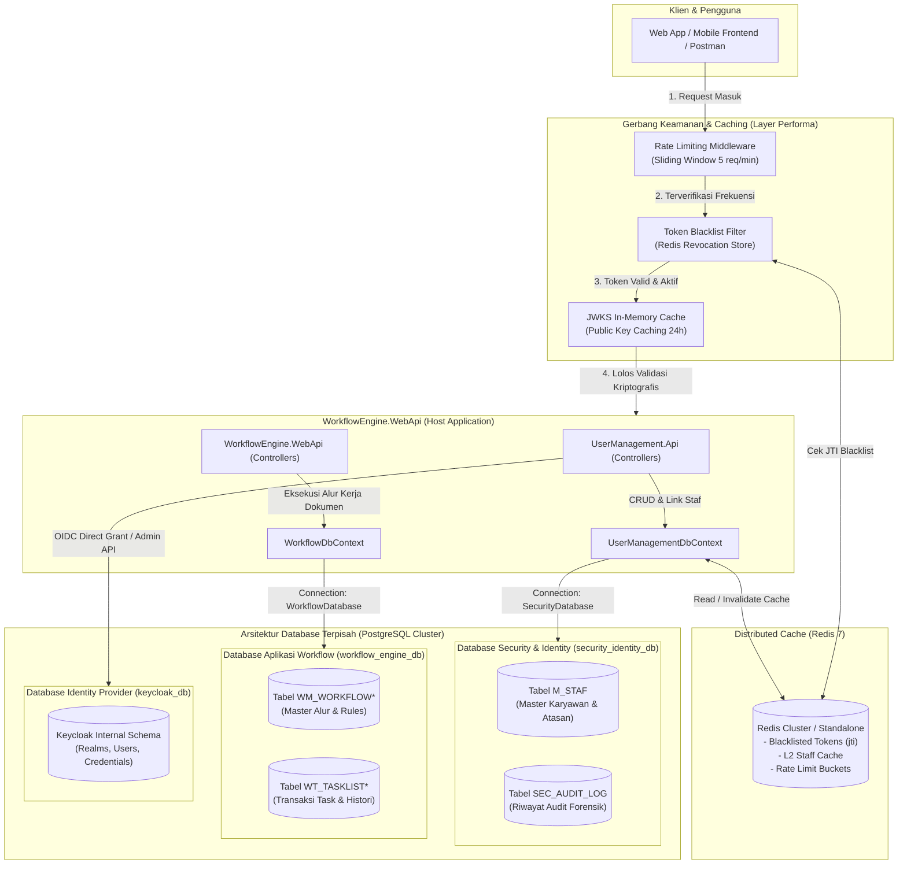
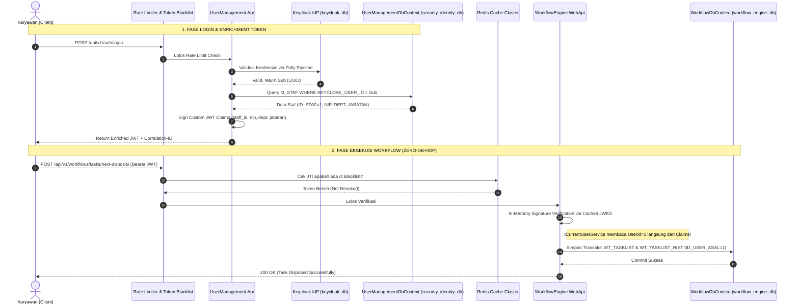

# 🛡️ SPESIFIKASI ARSITEKTUR & DESAIN TEKNIS TINGKAT ENTERPRISE INTERNASIONAL
# MODUL USER MANAGEMENT, AUTENTIKASI KEYCLOAK, PEMISAHAN DATABASE & PENGUATAN KEAMANAN TINGGI

> **Versi Dokumen**: 2.2.0 (International Enterprise & High-Performance Hardened)  
> **Status**: Approved Architectural & Security Specification  
> **Target Framework**: .NET 10 LTS (C# 13) / Kompatibel dengan .NET 8 LTS  
> **Pola Arsitektur**: Clean Architecture, Decoupled Modular Monolith, Database-per-Domain & Zero-Trust Architecture  
> **Standar Kepatuhan**: OWASP Top 10 (2021/2025), OWASP ASVS v4.0, NIST SP 800-63B, ISO/IEC 27001 & UU PDP / GDPR  
> **Database Engine**: PostgreSQL 15+ (Multi-Database Topology) / Microsoft SQL Server  
> **Identity Provider (IdP)**: Keycloak 24+ (OpenID Connect / OAuth2 & Keycloak Admin REST API)  
> **Distributed Cache & State**: Redis 7+ (Token Blacklist, Rate Limiting & Staff L2 Caching)  

---

## 1. PENDAHULUAN & PRINSIP DESAIN UTAMA

### 1.1 Latar Belakang & Tujuan
Dokumen ini merupakan cetak biru (*blueprint*) arsitektur keamanan, manajemen identitas pengguna, dan integrasi master data kepegawaian internal (`M_STAF`) yang dirancang untuk memenuhi **standar internasional perbankan dan enterprise modern**. Modul ini menjamin pemisahan tanggung jawab secara penuh (*separation of concerns*), performa tinggi (*sub-millisecond overhead*), ketersediaan tinggi (*high availability*), serta ketahanan terhadap ancaman siber kontemporer.

### 1.2 Prinsip Desain Utama

1. **Pemisahan Fisik Database (Database-per-Domain Pattern)**:
   - Database Aplikasi Workflow (`workflow_engine_db`) dan Database Security/Karyawan (`security_identity_db`) dipisahkan secara fisik.
   - Tidak ada *Foreign Key* fisik lintas database. Keterkaitan antar-domain dihubungkan via *Canonical Actor ID* (`BIGINT`) dan kontrak antarmuka (*Service Boundary*).
2. **Zero-Trust Architecture & Mandatory Authentication**:
   - Prinsip *"Never Trust, Always Verify"*. Setiap pemanggilan API wajib memvalidasi Bearer JWT yang sah dengan tanda tangan kriptografis asimetris (RS256/ES256).
3. **Strict 1-to-1 User & Staff Invariant**:
   - 1 Karyawan aktif hanya boleh memiliki maksimal 1 akun login Keycloak aktif. Aturan ini ditegakkan di level database (*Filtered Unique Index*) dan level aplikasi (*Domain Rule Enforcement*).
4. **Zero-DB-Hop Runtime Execution via Enriched Claims**:
   - Token JWT diperkaya (*enriched*) dengan klaim karyawan: `staff_id`, `staff_nip`, `department_code`, dan `position_code`. Pemrosesan transaksi alur kerja berjalan *in-memory* dari token claims tanpa perlu *query cross-database*.
5. **High Performance & Distributed Caching**:
   - Caching publik key JWKS Keycloak di memori lokal (*in-memory*) dan L2 Distributed Cache (Redis) untuk direktori hierarki kepegawaian guna mencegah bottleneck IdP dan database.
6. **Defense-in-Depth & Anti-Brute-Force**:
   - Penerapan *Rate Limiting* adaptif, mekanisme pencabutan token seketika (*Token Blacklisting/Revocation*), dan *Security Headers* standar OWASP.
7. **Kepatuhan Privasi Data (ISO 27001 & UU PDP / GDPR)**:
   - Penyamaran data sensitif (*PII Masking*) pada sistem logging dan pencatatan audit forensik dengan korelasi terdistribusi (*W3C Trace Context / Correlation ID*).

---

## 2. MATRIKS EVALUASI & GAP ANALYSIS STANDAR ENTERPRISE

| Kriteria / Standar | Status Awal | Penyempurnaan Standar Enterprise v2.2 |
|---|---|---|
| **Topologi Database** | Single Database (`workflow_engine_db`) | **Multi-Database Terisolasi**: `workflow_engine_db` (Aplikasi), `security_identity_db` (Security/Staf), dan `keycloak_db` (IdP) |
| **Integritas Relasi Staf** | Rentan double-linking akun | **Strict 1-to-1 Filtered Unique Index** di PostgreSQL + Enforce di Domain Layer |
| **Anti-Brute Force (OWASP ASVS V2.2)** | Belum ada batasan frekuensi login | **Sliding Window Rate Limiter**: Maks. 5 percobaan login gagal/menit per IP & Username (`HTTP 429`) |
| **Pencabutan Token (RFC 7009)** | JWT stateless aktif hingga expired (60m) | **Distributed Token Blacklisting (Redis)**: Pencabutan instan saat logout, pemutusan staf, atau pergantian password |
| **Beban Validasi IdP (Performa)** | Potensi request berulang ke Keycloak | **JWKS In-Memory Caching (24h sliding)**: 0 HTTP request ke Keycloak saat verifikasi token JWT normal |
| **Caching Direktori Staf** | Query database berulang untuk approver | **Distributed L2 Cache (Redis)**: Cache hierarki & atasan langsung (TTL 30 menit) + invalidasi berbasis event |
| **Resiliensi IdP (Fault Tolerance)** | Tidak ada proteksi cascading failure | **Polly Resilience Pipeline**: Circuit Breaker (30s window), Exponential Retry + Jitter, Timeout 5 detik |
| **Graceful Degradation** | IdP down berisiko membuat API lumpuh | **Stateless Verification Resilience**: Transaksi workflow tetap berjalan normal walau Keycloak blip sesaat |
| **Perlindungan Data PII (UU PDP)** | Potensi kebocoran NIP/HP di trace log | **PII Masking Engine**: Masking otomatis nomor HP (`0812****5432`) dan Email (`b***@company.co.id`) pada logging |
| **Audit Forensik (ISO 27001)** | Log standar console | **Structured Tamper-Evident Audit (`SEC_AUDIT_LOG`)** dengan `X-Correlation-ID` terdistribusi |

---

## 3. ARSITEKTUR MULTI-DATABASE (APPLICATION DB VS SECURITY DB)

### 3.1 Topologi Database & Aliran Data



### 3.2 Pemisahan Tanggung Jawab Database

| Atribut | Database Aplikasi (`workflow_engine_db`) | Database Security (`security_identity_db`) | Database IdP (`keycloak_db`) |
|---|---|---|---|
| **Peran Utama** | State machine alur kerja, penugasan, disposisi, delegasi, task approval | Master data kepegawaian internal, profil staf, audit autentikasi, relasi hierarki | Penyimpanan kredensial (hash password Argon2/PBKDF2), SSO realm, token sessions |
| **Entitas / Tabel** | `WM_WORKFLOW*`, `WT_TASKLIST*`, `WT_TASKLIST_HIST`, `WT_TASKLIST_ATTACHMENT`, `WT_TASKLIST_ASSIGNEE` | `M_STAF`, `SEC_AUDIT_LOG` | Tabel internal Keycloak (Liquibase managed) |
| **DbContext EF Core** | `WorkflowDbContext` | `UserManagementDbContext` | N/A (Quarkus/Keycloak Engine) |
| **Kunci ConnectionString** | `ConnectionStrings:WorkflowDatabase` | `ConnectionStrings:SecurityDatabase` | `KC_DB_URL` (JDBC) |
| **Assembly Pemilik** | `WorkflowEngine.Infrastructure` | `UserManagement.Infrastructure` | Container Keycloak |
| **Karakteristik Transaksi** | *High Write / High Update* (Status alur dokumen berubah cepat) | *High Read / Low Write* (Data kepegawaian teratur & terjadwal) | *High Read*, sesi berdurasi pendek |

### 3.3 Aturan Integritas Lintas Database (Cross-Database Invariants)

1. **Zero Cross-Database Physical Foreign Keys**:
   - Database engine tidak mengizinkan FK fisik antar database logikal yang berbeda.
   - Tabel `WT_TASKLIST` di `workflow_engine_db` menyimpan aktor sebagai `ID_USER_ASAL` (`BIGINT`) dan `ID_USER_TUJUAN` (`BIGINT`). Nilai ini adalah **Canonical Actor ID** yang mereferensikan `M_STAF.ID_STAF` di `security_identity_db`.
2. **Validasi Eksistensi via Service Contract (`IStaffDirectoryService`)**:
   - Jika Workflow Engine membutuhkan validasi apakah target approver aktif, pengecekan dilakukan melalui abstraksi antarmuka `IStaffDirectoryService` (berbantuan cache L2 Redis).
3. **Decoupled Lifecycle & Maintenance**:
   - Backup, reindex, vacuum, atau migrasi pada `security_identity_db` tidak menimbulkan *table lock* atau *downtime* pada `workflow_engine_db`.

---

## 4. ARSITEKTUR MODULAR (DECOUPLED MONOLITH)

Struktur proyek dirancang dalam folder modular `src/Modules/UserManagement/` dengan prinsip Clean Architecture:

```text
d:\wakhid\.net project\workflow\
├── src/
│   ├── Modules/
│   │   └── UserManagement/
│   │       ├── UserManagement.Domain/                 # [Library Mandiri - Zero Dependency]
│   │       │   ├── Entities/
│   │       │   │   ├── MStaf.cs                       # Master Karyawan & Relasi Hierarki
│   │       │   │   └── SecAuditLog.cs                 # Entitas Audit Forensik
│   │       │   ├── Enums/
│   │       │   │   ├── UserAccountStatus.cs           # Active, Suspended, Resigned
│   │       │   │   └── StaffPositionLevel.cs          # Staff, SectionHead, Manager, Director
│   │       │   ├── Events/                            # StaffCreatedEvent, StaffDeactivatedEvent
│   │       │   └── Exceptions/                        # StaffNotFoundException, DuplicateLinkingException
│   │       │
│   │       ├── UserManagement.Application/            # [Library Mandiri - Logika Bisnis & Kontrak]
│   │       │   ├── Common/                            # DTOs, BaseResponse, PII Masking Utilities
│   │       │   ├── Interfaces/
│   │       │   │   ├── IKeycloakAuthService.cs        # Login, Register, Refresh, Revocation
│   │       │   │   ├── IKeycloakAdminService.cs       # Sync User, Role Assignment, Lock/Unlock
│   │       │   │   ├── IStaffManagementService.cs     # CRUD Staf, Link/Unlink, Provisioning
│   │       │   │   ├── IStaffDirectoryService.cs      # Kontrak Pembaca Staf untuk Aplikasi Luar (Workflow)
│   │       │   │   ├── ITokenBlacklistService.cs      # Blacklist Cache Provider (Redis/Memory)
│   │       │   │   └── IUserManagementDbContext.cs    # Kontrak Persistence Staf
│   │       │   └── Services/
│   │       │       ├── KeycloakAuthService.cs
│   │       │       ├── StaffManagementService.cs
│   │       │       └── CachedStaffDirectoryService.cs # Cache-aside L2 Decorator
│   │       │
│   │       ├── UserManagement.Infrastructure/         # [Library Mandiri - Data & External Provider]
│   │       │   ├── Keycloak/
│   │       │   │   ├── KeycloakHttpClient.cs          # HTTP Client ke Keycloak REST API
│   │       │   │   ├── KeycloakOptions.cs             # Options Pattern Configuration
│   │       │   │   └── KeycloakResiliencePolicies.cs  # Polly Pipeline (Circuit Breaker & Retry)
│   │       │   ├── Persistence/
│   │       │   │   ├── Configurations/
│   │       │   │   │   ├── MStafConfiguration.cs      # Entity Type Configuration & Filtered Index
│   │       │   │   │   └── SecAuditLogConfiguration.cs# Audit Log Configuration
│   │       │   │   ├── UserManagementDbContext.cs     # DbContext khusus 'security_identity_db'
│   │       │   │   └── Seed/                          # Initial Superadmin & Staff Seeder
│   │       │   ├── Caching/
│   │       │   │   └── RedisTokenBlacklistService.cs  # Implementasi Blacklist berbasis Redis
│   │       │   └── DependencyInjection.cs             # AddUserManagementInfrastructure()
│   │       │
│   │       └── UserManagement.Api/                    # [Library Mandiri - API Endpoints & Middlewares]
│   │           ├── Controllers/
│   │           │   ├── AuthController.cs              # /api/v1/auth (Login, Register, Refresh, Me)
│   │           │   ├── StaffController.cs             # /api/v1/staff (CRUD Staf, Link/Unlink, Provision)
│   │           │   └── UserAdminController.cs         # /api/v1/users (Superadmin Keycloak Management)
│   │           ├── Middlewares/
│   │           │   ├── TokenRevocationMiddleware.cs   # Pengecekan Token Blacklist
│   │           │   ├── CorrelationIdMiddleware.cs     # W3C Trace Context Injection
│   │           │   └── SecurityHeadersMiddleware.cs   # OWASP HSTS, CSP, X-Frame-Options
│   │           └── Extensions/
│   │               └── UserManagementModuleExtensions.cs # AddUserManagementModule() satu baris
│   │
│   ├── WorkflowEngine.Domain/                         # [Core Engine - Workflow State Machine]
│   ├── WorkflowEngine.Application/                    # [Core Engine - Menggunakan IStaffDirectoryService]
│   ├── WorkflowEngine.Infrastructure/                 # [Core Engine - DbContext khusus 'workflow_engine_db']
│   └── WorkflowEngine.WebApi/                         # [Host Application - Mengimpor kedua modul]
```

---

## 5. SKEMA DATA DATABASE SECURITY (`security_identity_db`)

### 5.1 Definisi Tabel `M_STAF` & `SEC_AUDIT_LOG`

```sql
-- DIJALANKAN PADA DATABASE: security_identity_db

-- 1. TABEL MASTER STAF
CREATE TABLE "M_STAF" (
    "ID_STAF" BIGINT GENERATED BY DEFAULT AS IDENTITY,
    "NIP" VARCHAR(30) NOT NULL,
    "NAMA_LENGKAP" VARCHAR(150) NOT NULL,
    "EMAIL" VARCHAR(100) NOT NULL,
    "NOMOR_HP" VARCHAR(25),
    "KODE_DEPARTEMEN" VARCHAR(50) NOT NULL,
    "KODE_JABATAN" VARCHAR(50) NOT NULL,
    "ID_ATASAN_LANGSUNG" BIGINT,
    "KEYCLOAK_USER_ID" VARCHAR(64),
    "IS_ACTIVE" BOOLEAN NOT NULL DEFAULT TRUE,
    "CREATED_DATE" TIMESTAMPTZ NOT NULL DEFAULT CURRENT_TIMESTAMP,
    "CREATED_BY" VARCHAR(50) NOT NULL,
    "UPDATED_DATE" TIMESTAMPTZ NOT NULL DEFAULT CURRENT_TIMESTAMP,
    "UPDATED_BY" VARCHAR(50) NOT NULL,
    
    CONSTRAINT "PK_M_STAF" PRIMARY KEY ("ID_STAF"),
    CONSTRAINT "UQ_M_STAF_NIP" UNIQUE ("NIP"),
    CONSTRAINT "UQ_M_STAF_EMAIL" UNIQUE ("EMAIL"),
    CONSTRAINT "FK_M_STAF_ATASAN" FOREIGN KEY ("ID_ATASAN_LANGSUNG") 
        REFERENCES "M_STAF" ("ID_STAF") ON DELETE RESTRICT
);

-- STRICT 1-TO-1 ACTIVE USER CONSTRAINT:
-- 1 User Keycloak hanya boleh terhubung ke 1 Karyawan Aktif
CREATE UNIQUE INDEX "UQ_M_STAF_KEYCLOAK_ACTIVE" 
ON "M_STAF" ("KEYCLOAK_USER_ID") 
WHERE "IS_ACTIVE" = TRUE AND "KEYCLOAK_USER_ID" IS NOT NULL;

-- Indeks Performa Lookup Organisasi
CREATE INDEX "IX_M_STAF_DEPT_JABATAN" ON "M_STAF" ("KODE_DEPARTEMEN", "KODE_JABATAN");
CREATE INDEX "IX_M_STAF_ATASAN" ON "M_STAF" ("ID_ATASAN_LANGSUNG");

-- 2. TABEL AUDIT FORENSIK KEAMANAN
CREATE TABLE "SEC_AUDIT_LOG" (
    "ID_LOG" BIGINT GENERATED BY DEFAULT AS IDENTITY,
    "CORRELATION_ID" VARCHAR(64) NOT NULL,
    "ACTION_NAME" VARCHAR(100) NOT NULL,
    "ACTOR_USER_ID" VARCHAR(64) NOT NULL,
    "ACTOR_STAFF_ID" BIGINT,
    "RESOURCE_NAME" VARCHAR(100) NOT NULL,
    "RESOURCE_ID" VARCHAR(100),
    "STATUS" VARCHAR(20) NOT NULL, -- SUCCESS, FAILED, BLOCKED
    "CLIENT_IP" VARCHAR(45) NOT NULL,
    "USER_AGENT" VARCHAR(255),
    "PAYLOAD_SNAPSHOT" JSONB,
    "TIMESTAMP" TIMESTAMPTZ NOT NULL DEFAULT CURRENT_TIMESTAMP,
    
    CONSTRAINT "PK_SEC_AUDIT_LOG" PRIMARY KEY ("ID_LOG")
);

CREATE INDEX "IX_SEC_AUDIT_CORRELATION" ON "SEC_AUDIT_LOG" ("CORRELATION_ID");
CREATE INDEX "IX_SEC_AUDIT_TIMESTAMP" ON "SEC_AUDIT_LOG" ("TIMESTAMP" DESC);
CREATE INDEX "IX_SEC_AUDIT_STAFF" ON "SEC_AUDIT_LOG" ("ACTOR_STAFF_ID");
```

---

## 6. SPESIFIKASI REST API MODUL USER MANAGEMENT

Semua response API dibungkus oleh format standar enterprise `BaseResponse<T>` dan dilengkapi response headers:
- `X-Correlation-ID`: GUID pelacakan terdistribusi
- `X-RateLimit-Limit`, `X-RateLimit-Remaining`, `X-RateLimit-Reset`

### 6.1 Endpoint Autentikasi & Akun (`/api/v1/auth`)

| Method | Endpoint | Hak Akses | Rate Limit | Keterangan & Tujuan |
|---|---|---|---|---|
| `POST` | `/api/v1/auth/register` | Public | 3 req/jam/IP | Pendaftaran mandiri user staf baru (memvalidasi NIP/Email staf) |
| `POST` | `/api/v1/auth/login` | Public | 5 req/menit/IP | Login pengguna, menghasilkan JWT Access Token & Refresh Token |
| `POST` | `/api/v1/auth/refresh-token` | Public | 10 req/menit | Menukar Refresh Token untuk mendapatkan Access Token baru |
| `POST` | `/api/v1/auth/forgot-password` | Public | 3 req/15 mnt | Memicu email reset password via Keycloak |
| `POST` | `/api/v1/auth/change-password` | Authenticated | 5 req/15 mnt | Mengubah password akun aktif & revokasi token sesi lama |
| `GET` | `/api/v1/auth/me` | Authenticated | Standard | Mengambil profil user aktif, data staf dari `security_identity_db`, dan roles |
| `POST` | `/api/v1/auth/logout` | Authenticated | Standard | Melakukan pembatalan/revocation sesi aktif di Keycloak & Blacklist Token di Redis |

#### Contoh Respon Login Sukses (`200 OK`):
```json
{
  "success": true,
  "message": "Autentikasi berhasil",
  "data": {
    "accessToken": "eyJhbGciOiJSUzI1NiIsInR5cCI6IkpXVCJ9...",
    "refreshToken": "eyJhbGciOiJSUzI1NiIsInR5cCI6IkpXVCJ9...",
    "expiresInSeconds": 3600,
    "refreshExpiresInSeconds": 86400,
    "tokenType": "Bearer",
    "user": {
      "keycloakUserId": "a8c90962-d27a-4ec6-8c46-991c01e6191b",
      "username": "budi.santoso",
      "email": "budi.santoso@company.co.id",
      "roles": ["ROLE_USER", "ROLE_SECTION_HEAD"],
      "staffInfo": {
        "idStaf": 1,
        "nip": "STAF-2026-001",
        "namaLengkap": "Budi Santoso, S.Kom",
        "kodeDepartemen": "IT_INFRA",
        "kodeJabatan": "SECTION_HEAD",
        "idAtasanLangsung": 2
      }
    }
  }
}
```

---

### 6.2 Endpoint Manajemen Karyawan (`/api/v1/staff`)

| Method | Endpoint | Hak Akses | Keterangan & Tujuan |
|---|---|---|---|
| `GET` | `/api/v1/staff` | SuperAdmin / HRD | Mengambil daftar seluruh karyawan dari `security_identity_db` (Pagination) |
| `GET` | `/api/v1/staff/{id}` | SuperAdmin / HRD | Mengambil detail karyawan beserta profil akun Keycloak terkait |
| `POST` | `/api/v1/staff` | SuperAdmin / HRD | Menambahkan data master staf baru ke `security_identity_db` |
| `PUT` | `/api/v1/staff/{id}` | SuperAdmin / HRD | Memperbarui data staf & menginvalidasi cache Redis terkait |
| `DELETE` | `/api/v1/staff/{id}` | SuperAdmin / HRD | Soft delete staf, disable user Keycloak, & revokasi token aktif instan |
| `POST` | `/api/v1/staff/{id}/link-user` | SuperAdmin | Menautkan staf dengan akun Keycloak (memvalidasi strict 1-to-1) |
| `POST` | `/api/v1/staff/{id}/unlink-user` | SuperAdmin | Melepaskan tautan akun Keycloak dari data staf |
| `POST` | `/api/v1/staff/provision` | SuperAdmin / HRD | **One-Step Provisioning**: Menambahkan data Staf sekaligus akun Keycloak |

---

## 7. MEKANISME INTERKONEKSI LINTAS DATABASE & INTEGRASI WORKFLOW

### 7.1 Alur Interkoneksi Lintas Database



### 7.2 Zero-Hop Runtime Execution via JWT Claims
Setiap token memuat klaim yang siap dikonsumsi langsung oleh memori aplikasi:
- `sub`: Keycloak User ID (GUID string)
- `preferred_username`: Username akun
- `email`: Alamat email
- `realm_access.roles`: Hak akses (`ROLE_SUPERADMIN`, `ROLE_USER`, `ROLE_APPROVER`)
- `staff_id`: `M_STAF.ID_STAF` (`long` canonical ID)
- `staff_nip`: Nomor Induk Pegawai
- `department_code`: Kode departemen saat ini
- `position_code`: Kode jabatan saat ini
- `jti`: JWT Unique ID (digunakan untuk blacklist revocation)

### 7.3 Decoupled Service Contract (`IStaffDirectoryService`)
```csharp
namespace WorkflowEngine.Application.Interfaces;

public interface IStaffDirectoryService
{
    Task<StaffSummaryDto?> GetStaffByIdAsync(long staffId, CancellationToken cancellationToken = default);
    Task<StaffSummaryDto?> GetImmediateSupervisorAsync(long staffId, CancellationToken cancellationToken = default);
    Task<IReadOnlyList<StaffSummaryDto>> GetStaffByDepartmentAndPositionAsync(string departmentCode, string positionCode, CancellationToken cancellationToken = default);
}
```

---

## 8. STANDAR PENGERASAN KEAMANAN (SECURITY HARDENING & OWASP CONTROLS)

### 8.1 Kebijakan Rate Limiting & Anti-Brute-Force
Untuk mencegah serangan *Brute Force* dan *Credential Stuffing* (OWASP ASVS V2.2), diterapkan ASP.NET Core `RateLimiter`:

```csharp
builder.Services.AddRateLimiter(options =>
{
    // Policy untuk Login: Maksimal 5 percobaan gagal per 60 detik per kombinasi IP + Username
    options.AddSlidingWindowLimiter("AuthLoginPolicy", opt =>
    {
        opt.PermitLimit = 5;
        opt.Window = TimeSpan.FromMinutes(1);
        opt.SegmentsPerWindow = 6;
        opt.QueueProcessingOrder = QueueProcessingOrder.OldestFirst;
        opt.QueueLimit = 0;
    });

    options.RejectionStatusCode = StatusCodes.Status429TooManyRequests;
});
```

### 8.2 Token Revocation & Blacklisting Architecture (RFC 7009)
Mengingat JWT bersifat *stateless*, modul menerapkan **Distributed Token Blacklisting** menggunakan Redis:
1. **Mekanisme Blacklist**:
   - Saat pengguna memanggil `/api/v1/auth/logout` atau sandi diubah, klaim `jti` (JWT ID) disimpan ke Redis dengan key `blacklist:jti:{jti}` dan TTL sama dengan sisa masa berlaku token (`exp - now`).
2. **Event-Driven Cascade Deactivation**:
   - Jika karyawan dinonaktifkan (`DELETE /api/v1/staff/{id}`), sistem memancarkan `StaffDeactivatedEvent`. Handler akan mendaftarkan seluruh sesi token staf tersebut ke blacklist dan memanggil Keycloak Admin REST API untuk menghentikan seluruh sesi aktif seketika.
3. **Middleware Verifikasi Cepat**:
   - `TokenRevocationMiddleware` memeriksa keberadaan `jti` di Redis cache. Operasi ini berlangsung kurang dari 1 milidetik (*sub-millisecond overhead*).

### 8.3 OWASP Security HTTP Headers & CORS Policy
Setiap response HTTP dari aplikasi wajib menyertakan header keamanan berikut:

```http
Strict-Transport-Security: max-age=31536000; includeSubDomains; preload
X-Content-Type-Options: nosniff
X-Frame-Options: DENY
Referrer-Policy: strict-origin-when-cross-origin
Content-Security-Policy: default-src 'self'; frame-ancestors 'none';
Permissions-Policy: geolocation=(), camera=(), microphone=()
```

---

## 9. ARSITEKTUR PERFORMA TINGGI & RESILIENSI (HIGH PERFORMANCE & RELIABILITY)

### 9.1 JWKS In-Memory Caching & Asymmetric Verification
Untuk menghindari ketergantungan jaringan (*network round-trip*) ke Keycloak pada setiap verifikasi token:
- Kunci publik (*JWKS*) diunduh dan disimpan di memori lokal (*in-memory*) melalui `ConfigurationManager<OpenIdConnectConfiguration>`.
- **Waktu Refresh**: Cache berlaku selama 24 jam secara otomatis.
- **Auto Key Rollover**: Jika token membawa Key ID (`kid`) baru yang tidak ada di cache lokal, sistem otomatis melakukan sinkronisasi ulang ke endpoint `/.well-known/openid-configuration/jwks` Keycloak tanpa menimbulkan *downtime*.

### 9.2 Distributed L2 Caching (Redis) untuk Direktori Staf
Pembacaan data master staf pada `IStaffDirectoryService` dibungkus dengan pola **Cache-Aside Pattern**:
- **Cache Key**: `cache:staff:{id}`, `cache:staff:dept:{deptCode}:{posCode}`.
- **TTL**: 30 menit dengan sliding expiration.
- **Invalidasi Otomatis**: Setiap operasi mutasi staf (`POST`, `PUT`, `DELETE` pada `/api/v1/staff`) otomatis menginvalidasi *cache keys* yang terkait sehingga konsistensi data tetap terjamin (*event-driven cache eviction*).

### 9.3 Polly Resilience Pipeline (Circuit Breaker & Retry)
Komunikasi HTTP keluar ke Keycloak dilindungi oleh pipeline resiliensi Polly:

```csharp
var resiliencePipeline = new ResiliencePipelineBuilder<HttpResponseMessage>()
    .AddRetry(new RetryStrategyOptions<HttpResponseMessage>
    {
        MaxRetryAttempts = 3,
        Delay = TimeSpan.FromMilliseconds(200),
        BackoffType = DelayBackoffType.Exponential,
        UseJitter = true
    })
    .AddCircuitBreaker(new CircuitBreakerStrategyOptions<HttpResponseMessage>
    {
        FailureRatio = 0.5,
        SamplingDuration = TimeSpan.FromSeconds(30),
        MinimumThroughput = 10,
        BreakDuration = TimeSpan.FromSeconds(30)
    })
    .AddTimeout(TimeSpan.FromSeconds(5))
    .Build();
```

### 9.4 Graceful Degradation Strategy
Jika server Keycloak mengalami gangguan jaringan sesaat:
- **Transaksi Alur Kerja Tetap Berjalan**: Modul workflow tetap dapat memproses task, menyetujui, dan mendisposisi dokumen secara lancar karena verifikasi Bearer JWT menggunakan kunci publik JWKS lokal di memori.
- **Kegagalan Terisolasi**: Hanya fungsi login baru yang sementara terdampak, sehingga transaksi operasional perusahaan tidak terhenti total (*high availability assurance*).

---

## 10. PERLINDUNGAN DATA PRIBADI & AUDIT LOGGING (ISO 27001 & UU PDP)

### 10.1 PII Masking Engine (Data Sanitization)
Sesuai amanat UU Pelindungan Data Pribadi (UU PDP) dan ISO/IEC 27001, log aplikasi dan telemetry dilarang keras menyimpan data sensitif dalam bentuk teks polos (*plain text*):
- **Nomor Handphone**: Dimasking menjadi format `0812****5432`.
- **Alamat Email**: Dimasking menjadi format `b***@company.co.id`.
- **Kredensial & Token**: Nilai password, client secret, dan bearer token disanitasi menjadi `[REDACTED]`.

### 10.2 W3C Distributed Tracing (`X-Correlation-ID`)
Setiap request HTTP masuk diinjeksi atau meneruskan header `X-Correlation-ID` (sesuai standar W3C Trace Context). Correlation ID ini dicatat pada:
1. HTTP Response Header
2. Serilog Diagnostic Context
3. Entitas `SEC_AUDIT_LOG`
4. Riwayat transaksi workflow `WT_TASKLIST_HIST`

Hal ini menjamin kemampuan investigasi forensik menyeluruh (*end-to-end non-repudiation*) jika terjadi insiden keamanan atau perselisihan persetujuan alur kerja.

---

## 11. PANDUAN PENGGUNAAN ULANG PADA PROYEK LAIN (REUSABILITY GUIDE)

Ketika proyek .NET Core baru (misal: *E-Procurement*, *HR-Portal*, *Asset Management*) dibangun:

1. **Tambahkan Referensi Project**:
   ```bash
   dotnet add reference ../Modules/UserManagement/UserManagement.Api/UserManagement.Api.csproj
   ```

2. **Daftarkan Modul di `Program.cs` Hanya dengan 1 Baris**:
   ```csharp
   // Mendaftarkan Controllers, Middlewares, Polly Pipeline, Redis Cache, EF DbContext, dan Auth Handlers
   builder.Services.AddUserManagementModule(builder.Configuration);
   ```

3. **Pasang Middleware Keamanan**:
   ```csharp
   app.UseSecurityHeaders();
   app.UseCorrelationId();
   app.UseRateLimiter();
   app.UseAuthentication();
   app.UseTokenRevocation();
   app.UseAuthorization();
   ```

4. **Konfigurasi `appsettings.json`**:
   ```json
   {
     "ConnectionStrings": {
       "WorkflowDatabase": "Host=localhost;Port=5432;Database=workflow_engine_db;Username=postgres;Password=postgres;Pooling=true;MinPoolSize=10;MaxPoolSize=100;",
       "SecurityDatabase": "Host=localhost;Port=5432;Database=security_identity_db;Username=postgres;Password=postgres;Pooling=true;MinPoolSize=10;MaxPoolSize=100;",
       "Redis": "localhost:6379,abortConnect=false"
     },
     "Keycloak": {
       "Realm": "EnterpriseRealm",
       "AuthServerUrl": "http://localhost:8080/",
       "ClientId": "workflow-backend-api",
       "ClientSecret": "your-client-secret-here",
       "AdminUsername": "admin",
       "AdminPassword": "adminpassword"
     }
   }
   ```

---

## 12. KONFIGURASI DOCKER COMPOSE MULTI-DATABASE & INFRASTRUKTUR

Berikut konfigurasi infrastruktur lengkap (PostgreSQL Multi-DB, Keycloak, dan Redis) pada `docker-compose.yml`:

### 12.1 Skrip Inisialisasi Database (`docker/postgres-init/01-init-databases.sh`):
```bash
#!/bin/bash
set -e

psql -v ON_ERROR_STOP=1 --username "$POSTGRES_USER" <<-EOSQL
    CREATE DATABASE workflow_engine_db;
    CREATE DATABASE security_identity_db;
    CREATE DATABASE keycloak_db;
    GRANT ALL PRIVILEGES ON DATABASE workflow_engine_db TO $POSTGRES_USER;
    GRANT ALL PRIVILEGES ON DATABASE security_identity_db TO $POSTGRES_USER;
    GRANT ALL PRIVILEGES ON DATABASE keycloak_db TO $POSTGRES_USER;
EOSQL
```

### 12.2 Service Definition pada `docker-compose.yml`:
```yaml
services:
  postgres:
    image: postgres:15-alpine
    pull_policy: never
    container_name: workflow-postgres
    restart: unless-stopped
    environment:
      POSTGRES_USER: postgres
      POSTGRES_PASSWORD: postgres
      POSTGRES_DB: workflow_engine_db
    ports:
      - "5432:5432"
    volumes:
      - postgres_data:/var/lib/postgresql/data
      - ./docker/postgres-init:/docker-entrypoint-initdb.d:ro
    healthcheck:
      test: ["CMD-SHELL", "pg_isready -U postgres"]
      interval: 5s
      timeout: 5s
      retries: 5

  redis:
    image: redis:7-alpine
    container_name: workflow-redis
    restart: unless-stopped
    ports:
      - "6379:6379"
    healthcheck:
      test: ["CMD", "redis-cli", "ping"]
      interval: 5s
      timeout: 5s
      retries: 5

  keycloak:
    image: quay.io/keycloak/keycloak:24.0.5
    container_name: workflow-keycloak
    restart: unless-stopped
    command: start-dev --import-realm
    environment:
      KEYCLOAK_ADMIN: admin
      KEYCLOAK_ADMIN_PASSWORD: admin
      KC_DB: postgres
      KC_DB_URL: jdbc:postgresql://postgres:5432/keycloak_db
      KC_DB_USERNAME: postgres
      KC_DB_PASSWORD: postgres
    ports:
      - "8080:8080"
    depends_on:
      postgres:
        condition: service_healthy
```

---

## 13. TAHAPAN IMPLEMENTASI & MATRIKS VERIFIKASI KEAMANAN (ROADMAP)

Ketika tahap persetujuan dokumen arsitektur ini selesai, implementasi teknis dieksekusi dalam 4 fase terstruktur:

1. **Fase 1: Multi-Database Setup & Domain Core `M_STAF`**:
   - Penyediaan skrip inisialisasi Docker `01-init-databases.sh` (`workflow_engine_db`, `security_identity_db`, `keycloak_db`).
   - Inisialisasi folder modul `src/Modules/UserManagement/`.
   - Setup `UserManagementDbContext` terarah ke connection string `SecurityDatabase`.
   - Eksekusi skrip DDL `M_STAF` dan indeks unik 1-to-1 di `security_identity_db`.
2. **Fase 2: Layanan Komunikasi Keycloak, Polly & Caching**:
   - Implementasi `KeycloakHttpClient` dengan Polly Pipeline (Circuit Breaker, Exponential Retry).
   - Implementasi `StaffManagementService` (Validasi strict 1-to-1 linking).
   - Implementasi `RedisTokenBlacklistService` dan `CachedStaffDirectoryService`.
3. **Fase 3: REST API Controllers & Security Middlewares**:
   - Implementasi `AuthController` (`/api/v1/auth`), `StaffController` (`/api/v1/staff`), dan `UserAdminController`.
   - Konfigurasi `RateLimiter`, `TokenRevocationMiddleware`, `CorrelationIdMiddleware`, dan `SecurityHeadersMiddleware`.
   - Setup JWT Bearer Authentication dengan JWKS In-Memory Caching & Claims Transformation.
4. **Fase 4: Verifikasi & Interkoneksi Workflow Engine**:
   - Penyesuaian `ICurrentUserService` pada host WebApi untuk membaca claims `staff_id`, `department_code`, dan `position_code`.
   - Verifikasi isolasi database: memastikan transaksi `WT_TASKLIST` berjalan lancar di `workflow_engine_db` tanpa FK fisik ke `security_identity_db`.
   - **Eksekusi Pengujian Otomatis (*Automated Security Tests*)**:
     - Unit test pencegahan double-linking akun staf.
     - Integration test penolakan brute force (`HTTP 429 Too Many Requests`).
     - Integration test pemblokiran token yang telah di-revoke / di-blacklist.
     - Verifikasi zero cross-database lock saat transaksi workflow volume tinggi.