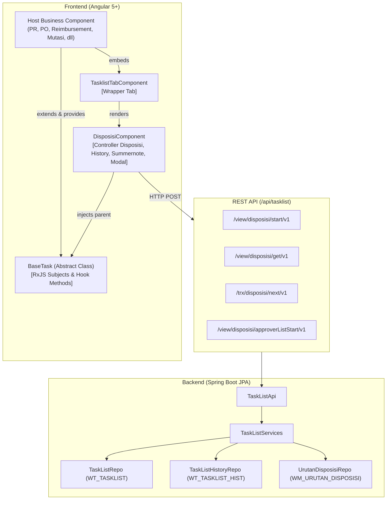
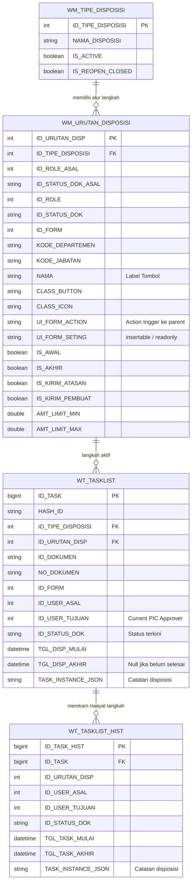
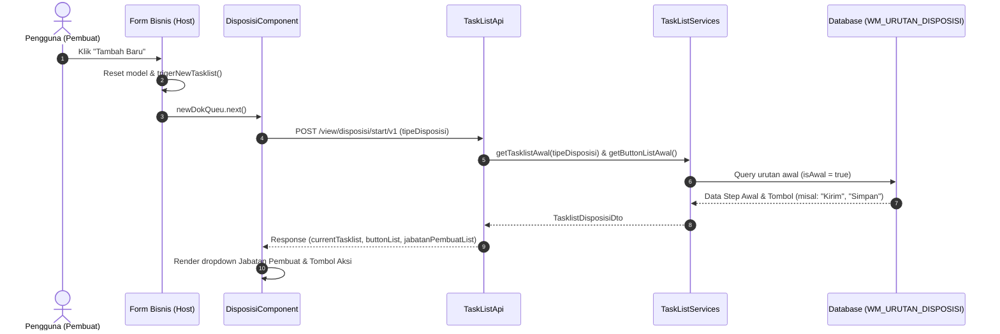
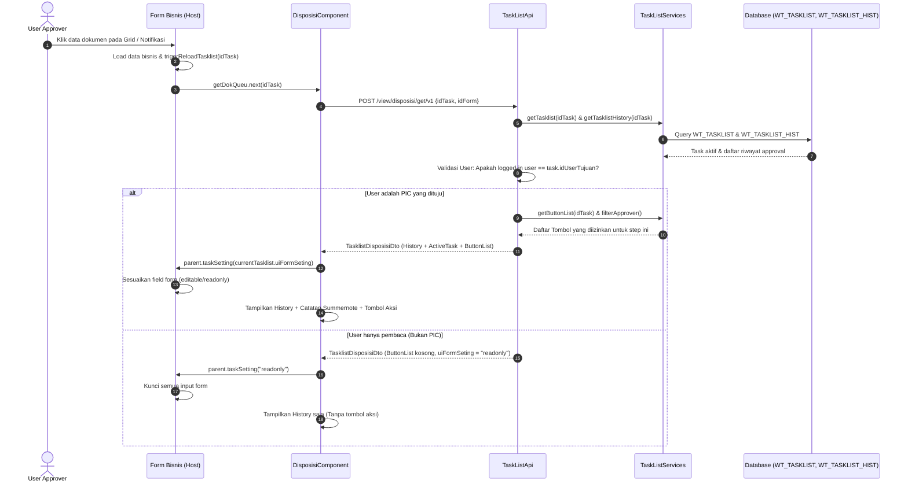
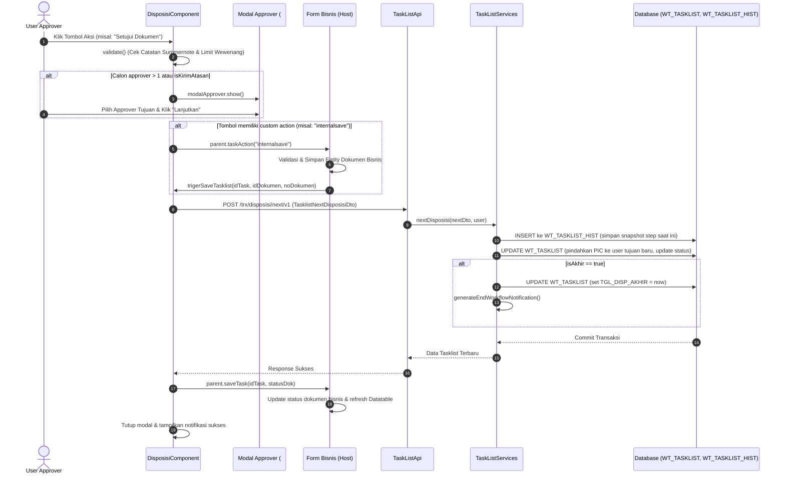
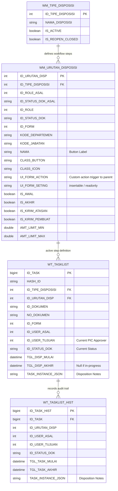
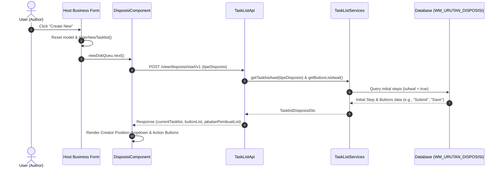
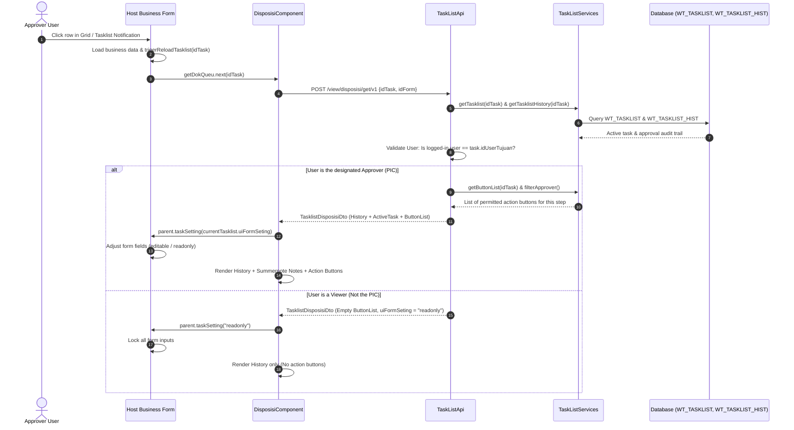
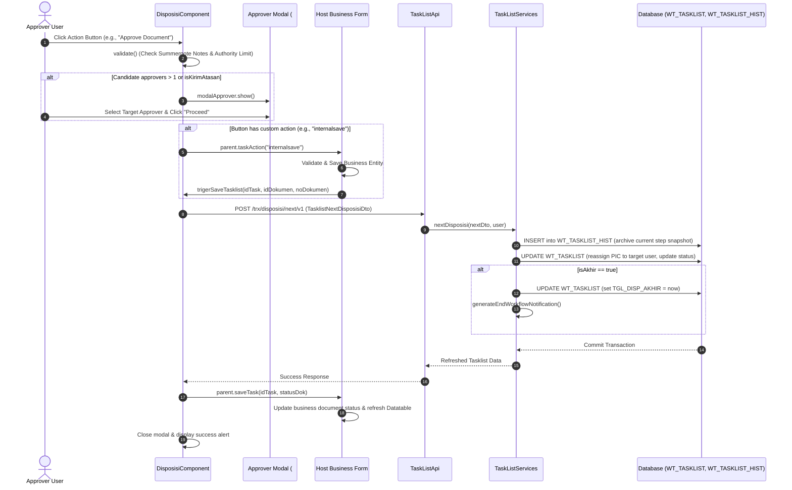

# Workflow-Architecture-2026
Workflow Architecture is the intentional design and structural organization of how work—encompassing tasks, data, human roles, and system integrations—moves from initiation to completion.
# Workflow-Architecture
Workflow Architecture is the intentional design and structural organization of how work—encompassing tasks, data, human roles, and system integrations—moves from initiation to completion.

# DOKUMENTASI PROSES DISPOSISI & PERSETUJUAN (WORKFLOW ENGINE) 
#  DISPOSITION & APPROVAL WORKFLOW ENGINE DOCUMENTATION

> **PILIH BAHASA / SELECT LANGUAGE:**
> - 🇮🇩 [Bahasa Indonesia](#-versi-bahasa-indonesia)
> - 🇬🇧 [English Version](#-english-version)

---

# 🇮🇩 VERSI BAHASA INDONESIA

Dokumentasi ini menjelaskan secara komprehensif cara kerja sistem **Disposisi & Persetujuan (Workflow / Tasklist)** pada sistem , mulai dari lapisan antarmuka pengguna (Frontend Angular), komunikasi REST API, logika pemrosesan data (Backend Spring Boot/JPA), struktur database, hingga **panduan langkah-demi-langkah (step-by-step guide)** untuk melakukan modifikasi atau penambahan alur persetujuan baru.

---

## DAFTAR ISI (BAHASA INDONESIA)
1. [Ringkasan Arsitektur Sistem](#1-ringkasan-arsitektur-sistem)
2. [Struktur Basis Data & Model Data](#2-struktur-basis-data--model-data)
3. [Alur Kerja Frontend (Angular)](#3-alur-kerja-frontend-angular)
   - [Peran Komponen: TasklistTabComponent & DisposisiComponent](#peran-komponen-tasklisttabcomponent--disposisicomponent)
   - [Kontrak Interaksi: BaseTask](#kontrak-interaksi-basetask)
   - [Siklus Hidup Form Bisnis (Form Lifecycle)](#siklus-hidup-form-bisnis-form-lifecycle)
4. [Alur Kerja Backend (Java Spring Boot)](#4-alur-kerja-backend-java-spring-boot)
   - [TaskListApi (REST Controller)](#tasklistapi-rest-controller)
   - [TaskListServices (Core Engine)](#tasklistservices-core-engine)
   - [Penentuan Approver & Validasi Limit Wewenang](#penentuan-approver--validasi-limit-wewenang)
5. [Diagram Alur (Sequence Diagrams)](#5-diagram-alur-sequence-diagrams)
   - [Alur 1: Membuka Dokumen Baru (Draft / Start)](#alur-1-membuka-dokumen-baru-draft--start)
   - [Alur 2: Membuka Dokumen Existing (Approval Step)](#alur-2-membuka-dokumen-existing-approval-step)
   - [Alur 3: Eksekusi Disposisi (Next / Submit Approval)](#alur-3-eksekusi-disposisi-next--submit-approval)
6. [Panduan Praktis Modifikasi & Implementasi Form Baru](#6-panduan-praktis-modifikasi--implementasi-form-baru)
   - [Langkah 1: Menghubungkan Form Baru ke Disposisi](#langkah-1-menghubungkan-form-baru-ke-disposisi)
   - [Langkah 2: Menambah Tombol / Step Baru pada Workflow](#langkah-2-menambah-tombol--step-baru-pada-workflow)
   - [Langkah 3: Menyesuaikan Hak Akses & Status Dokumen](#langkah-3-menyesuaikan-hak-akses--status-dokumen)
   - [Langkah 4: Debugging & Tips Penting](#langkah-4-debugging--tips-penting)
7. [Pembaruan Modern UI & Penghapusan Jabatan/Departemen](#7-pembaruan-modern-ui--penghapusan-jabatandepartemen)

---

## 1. RINGKASAN ARSITEKTUR SISTEM

Sistem persetujuan  menggunakan model **Data-Driven Dynamic State Machine**. Berbeda dari engine BPMN murni berbasis file XML (seperti Camunda/Activiti standalone), workflow pada  dikontrol langsung oleh tabel relasional master (`WM_TIPE_DISPOSISI` dan `WM_URUTAN_DISPOSISI`).



### Keunggulan Desain Ini:
1. **Dynamic Buttons**: Tombol aksi persetujuan ("Kirim ke Supervisor", "Approve", "Reject", "Revisi") tidak di-hardcode di HTML form, melainkan digenerate secara dinamis dari database sesuai posisi dokumen dan role user saat ini.
2. **Reusable Across All Modules**: Seluruh modul ISO (Procurement, FAT, Warehouse/Gudang, Marketing, HRD-GA) menggunakan komponen dan engine yang sama persis.
3. **Decoupled Architecture**: Form bisnis hanya perlu mengimplementasikan kontrak `BaseTask`, tanpa perlu memikirkan bagaimana query hirarki atasan, history audit, modal pemilih user, atau pengiriman notifikasi bekerja.

---

## 2. STRUKTUR BASIS DATA & MODEL DATA

Engine ini bertumpu pada 4 tabel utama:



### Detail Kolom Kunci di `WM_URUTAN_DISPOSISI`:
- **`ID_STATUS_DOK_ASAL` & `ID_ROLE_ASAL`**: Kriteria state saat ini agar tombol ini muncul. Jika task aktif berada pada status dan role ini, tombol akan dibuatkan untuk pengguna.
- **`ID_STATUS_DOK` & `ID_ROLE`**: State baru setelah tombol ditekan.
- **`IS_AWAL`**: Menandakan tombol awal saat dokumen pertama kali dibuat (`idTask == null`).
- **`IS_AKHIR`**: Menandakan bahwa langkah ini adalah persetujuan final. Saat dieksekusi, `WT_TASKLIST.TGL_DISP_AKHIR` diisi timestamp, dan workflow selesai.
- **`IS_KIRIM_ATASAN`**: Jika `true`, sistem akan mencari calon approver dari tabel relasi atasan (`stafDeptJabatanList.atasanList`) berdasarkan struktur organisasi user pembuat.
- **`IS_KIRIM_PEMBUAT`**: Jika `true` (biasanya tombol "Tolak" atau "Revisi"), sistem otomatis mencari user pertama yang membuat dokumen dari record `WT_TASKLIST_HIST` paling awal.
- **`UI_FORM_ACTION`**: Nama aksi kustom (contoh: `"internalsave"`, `"checking"`). Jika diisi, sebelum disposisi dikirim, `DisposisiComponent` akan memanggil method `parent.taskAction(uiFormAction)`.
- **`UI_FORM_SETING`**: String konfigurasi UI (contoh: `"insertable"`, `"readonly"`). `DisposisiComponent` akan memanggil `parent.taskSetting(uiFormSeting)` agar form bisnis mengunci atau membuka input field.
- **`AMT_LIMIT_MIN` & `AMT_LIMIT_MAX`**: Batas nilai moneter (Matrix of Authority). Nilai form dicek melalui `parent.getTaskAmount()`. Jika di luar limit wewenang, sistem membatalkan aksi dengan peringatan.

---

## 3. ALUR KERJA FRONTEND (ANGULAR)

### Peran Komponen
File utama di Frontend:
- `tasklist-tab.component.ts` & `.html`: Komponen kontainer tab. Menerima `@Input("tipeDisposisi")` dan `@Input("idForm")`.
- `disposisi.component.ts` & `.html`: Inti kontrol disposisi. Menampilkan timeline history, status terakhir, catatan disposisi (Summernote), tombol dinamis, dan modal pemilihan user berikutnya.
- `disposisi-view.component.ts`: Versi read-only (tanpa tombol aksi) untuk tampilan pratinjau dokumen.
- `base-task.ts`: Kelas abstrak dasar yang menjadi jembatan komunikasi antara Form Bisnis dan Komponen Disposisi.

### Kontrak Interaksi: `BaseTask` (`base-task.ts`)

`BaseTask` menggunakan pola **RxJS Subject Queue** dan **Template Method Pattern**:

```typescript
export abstract class BaseTask {
    // Subject pemanggil inisialisasi dokumen baru
    newDokQueu: Subject<any> = new Subject();
    // Subject reload data disposisi existing
    getDokQueu: Subject<any> = new Subject();
    // Subject eksekusi simpan/lanjutkan disposisi
    saveQueu: Subject<any> = new Subject();

    // Hook wajib diimplementasikan oleh Form Bisnis:
    abstract taskAction(actionName: string, status?: string | null): boolean;
    abstract taskSetting(uiSetting: string): void;
    abstract saveTask(idTask: string, status?: string | null): void;

    // Trigger methods yang dipanggil oleh Form Bisnis:
    trigerNewTasklist() { ... }
    trigerReloadTasklist(idTask: any) { ... }
    trigerSaveTasklist(idTask: any, idDokumen: any, noDokumen?: string | null) { ... }
    getTaskAmount() { return 0; }
}
```

### Siklus Hidup Form Bisnis (Form Lifecycle)

Setiap Form Dokumen ISO (seperti `PurchaseRequestComponent`) wajib:
1. Memperluas `BaseTask` (`export class PurchaseRequestComponent extends BaseTask`).
2. Mendaftarkan diri pada provider komponen menggunakan `forwardRef`:
   ```typescript
   @Component({
       selector: 'purchase-request',
       templateUrl: './purchase-request.component.html',
       providers: [
           { provide: BaseTask, useExisting: forwardRef(() => PurchaseRequestComponent) }
       ]
   })
   ```
3. Menempatkan `<tasklist-tab>` pada template HTML:
   ```html
   <tasklist-tab [tipeDisposisi]="headerDocComponent.getTipeDisposisi()" [idForm]="idForm"></tasklist-tab>
   ```

#### 3 Skenario Interaksi Utama:
1. **Saat Klik "Tambah / Buat Baru"**:
   - Form mereset model data.
   - Form memanggil `this.trigerNewTasklist()`.
   - `newDokQueu.next()` terpanggil.
   - `DisposisiComponent` menerima sinyal dan memanggil `getTask(null)` -> POST `/api/tasklist/view/disposisi/start/v1`.
2. **Saat Klik Baris Tabel Data (Membuka Dokumen Existing)**:
   - Form mengambil data header & detail dokumen dari API bisnis.
   - Form memanggil `this.trigerReloadTasklist(idTask)`.
   - `getDokQueu.next(idTask)` terpanggil.
   - `DisposisiComponent` menerima sinyal dan memanggil `getTask(idTask)` -> POST `/api/tasklist/view/disposisi/get/v1`.
   - Jika user saat ini adalah approver yang dituju, tombol aksi ditampilkan.
   - `DisposisiComponent` memanggil `parent.taskSetting(currentTasklist.uiFormSeting)`.
3. **Saat Menekan Tombol Disposisi ("Simpan", "Kirim", "Approve")**:
   - `DisposisiComponent.taskAction(button)` memvalidasi Summernote & Limit Wewenang.
   - Jika tombol memiliki `action` (misal `"internalsave"`):
     - Memanggil `parent.taskAction("internalsave")`.
     - Parent melakukan validasi form & menyimpan entity bisnis ke backend.
     - Setelah sukses simpan entity, parent memanggil:
       ```typescript
       this.trigerSaveTasklist(this.model.idTask, this.model.idDokumen, this.model.noDokumen);
       ```
     - `saveQueu.next(...)` memicu `DisposisiComponent.internalAction()`.
     - `DisposisiComponent` mengirim data ke `/api/tasklist/trx/disposisi/next/v1`.
     - Setelah sukses, `parent.saveTask(idTask, statusDok)` dipanggil untuk memperbarui `idTask` dan `statusDisposisi` di tabel bisnis, lalu merefresh datatable.

---

## 4. ALUR KERJA BACKEND (JAVA SPRING BOOT)

### TaskListApi (`TaskListApi.java`)
Mengekspos endpoint inti:
1. `POST /api/tasklist/view/disposisi/start/v1`:
   - Menerima `tipeDisposisi` (Integer).
   - Memanggil `taskListServices.getTasklistAwal()` dan `getButtonListAwal()`.
   - Mengambil daftar jabatan/departemen user via `stafService.getStafDeptJabatanForTasklist()`.
   - Memfilter kandidat approver awal via `filterApprover()`.
2. `POST /api/tasklist/view/disposisi/get/v1`:
   - Menerima `idTask` dan `idForm`.
   - Mengambil history approval via `taskListServices.getTasklistHistory(idTask)`.
   - Mengambil task aktif via `taskListServices.getTasklist(idTask)`.
   - **Security & Authorization Check**: Jika `userAktif.idUser == task.idUserTujuan` dan `idForm` cocok, sistem mengizinkan generate `buttonList` + calon approver. Jika bukan PIC yang dituju, tombol tidak dibuat dan task diset `uiFormSeting = "readonly"`.
3. `POST /api/tasklist/trx/disposisi/next/v1`:
   - Menerima payload `TasklistNextDisposisiDto`.
   - Mengeksekusi transaksi transisi status via `taskListServices.nextDisposisi()`.
   - Mengembalikan data tasklist terbaru yang sudah di-refresh.
4. `POST /api/tasklist/view/disposisi/approverListStart/v1`:
   - Dipanggil khusus saat step awal dengan `isKirimAtasan == true`.
   - Memecah data jabatan pembuat (`asalUser = "KODE_JABATAN##KODE_DEPARTEMEN"`) dan mencari atasan langsung di struktur organisasi.

### TaskListServices (`TaskListServices.java`)

Method paling krusial adalah `nextDisposisi(TasklistNextDisposisiDto nextDisposisiDto, UserEntity userExisting)`:
```
1. Cari UrutanDisposisiEntity berdasarkan idUrutanDisposisi terpilih.
2. JIKA idTask kosong:
   - Buat baru TaskListEntity di tabel WT_TASKLIST.
   - Set status awal, user pembuat sebagai asal, tglTaskMulai, catatan disposisi.
   - Simpan ke WT_TASKLIST dan generate HASH_ID.
3. JIKA idTask ada:
   - Ambil existing TaskListEntity dari database.
   - Cek kasus Re-Open Closed: jika task sudah selesai dan tipe disposisi mendukung reopen, buka kembali.
   - Cek kasus Update Catatan (idUrutanDisp sama): cukup update catatan di task dan history terakhir tanpa memindahkan user.
4. Alur Perpindahan Normal:
   a. Arsipkan state saat ini ke WT_TASKLIST_HIST (TaskListHistoryEntity):
      - Catat user asal, user tujuan sebelumnya, status dokumen asal, catatan disposisi, dan tglTaskAkhir = new Date().
   b. Perbarui WT_TASKLIST (TaskListEntity):
      - Geser idUserAsal = existing idUserTujuan.
      - Isi idUserTujuan = user baru yang dipilih (nextDisposisiDto.idUser).
      - Set idStatusDok = urutanDisposisiEntity.idStatusDok.
      - Set idUrutanDisp = urutanDisposisiEntity.idUrutanDisp.
      - Set tglTaskMulai = new Date().
   c. Cek Jika Langkah Akhir (urutanDisposisiEntity.isAkhir == true):
      - Set tglDispAkhir = new Date() (workflow selesai).
      - Jika bukan isKirimPembuat, kembalikan user tujuan ke penandatangan akhir.
   d. Simpan perubahan ke WT_TASKLIST.
   e. Kirim notifikasi sistem melalui notificationWorkflowService.generateEndWorkflowNotification(...).
```

### Penentuan Approver (`filterApprover`)
Ada 3 logika utama dalam menentukan daftar nama orang yang berhak menerima dokumen pada langkah selanjutnya:
1. **Berdasarkan Atasan Struktur Organisasi (`isKirimAtasan == true`)**:
   - Query `UrutanDisposisiRepo.getUserApproversAtasan(...)`.
   - Mengikuti mapping `DEPJAB.atasanList ATASAN` pada tabel staf user.
2. **Kembali ke Pembuat Dokumen (`isKirimPembuat == true`)**:
   - Query `UrutanDisposisiRepo.getUserCreator(idTask)`.
   - Mengambil `ID_USER_ASAL` dari record `WT_TASKLIST_HIST` dengan ID paling kecil (creator awal).
3. **Berdasarkan Mapping Role, Jabatan, & Departemen Standar**:
   - Query `UrutanDisposisiRepo.getUserApprovers(idUrutanDisposisi)`.
   - Mengambil semua user yang memiliki `ID_ROLE` yang disyaratkan. Jika kolom `KODE_DEPARTEMEN` dan `KODE_JABATAN` diisi pada master urutan, user akan difilter lebih spesifik hanya untuk divisi/jabatan tersebut.

---

## 5. DIAGRAM ALUR (SEQUENCE DIAGRAMS)

### Alur 1: Membuka Dokumen Baru (Draft / Start)


---

### Alur 2: Membuka Dokumen Existing (Approval Step)


---

### Alur 3: Eksekusi Disposisi (Next / Submit Approval)


---

## 6. PANDUAN PRAKTIS MODIFIKASI & IMPLEMENTASI FORM BARU

Gunakan panduan ini sebagai checklist teknis ketika Anda ingin menambahkan form baru ke dalam workflow atau memodifikasi alur persetujuan yang sudah ada.

### Langkah 1: Menghubungkan Form Baru ke Disposisi

1. **Konfigurasi Provider di Typescript Component**:
   Pastikan component form Anda meng-extend `BaseTask` dan menyediakan dirinya sendiri sebagai `BaseTask`:
   ```typescript
   import { forwardRef } from "@angular/core";
   import { BaseTask } from "../../../commons/base-task";

   @Component({
       selector: 'app-form-saya',
       templateUrl: './form-saya.component.html',
       providers: [
           { provide: BaseTask, useExisting: forwardRef(() => FormSayaComponent) }
       ]
   })
   export class FormSayaComponent extends BaseTask implements OnInit {
       idForm: string; // Ambil dari route atau konfigurasi menu
       tipeDisposisi: number = 101; // ID Tipe disposisi di tabel WM_TIPE_DISPOSISI
       ...
   ```

2. **Implementasikan 3 Hook Wajib**:
   ```typescript
   // 1. Eksekusi aksi kustom sebelum disposisi diproses
   taskAction(actionName: string, status?: string | null): boolean {
       switch (actionName) {
           case "internalsave":
               if (this.isFormValid()) {
                   this.saveDataBisnis();
                   return true;
               }
               return false;
           case "back":
               this.kembaliKeTabel();
               return false;
           default:
               return true;
       }
   }

   // 2. Kontrol editable / readonly form berdasarkan hak akses step saat ini
   taskSetting(uiSetting: string) {
       if (uiSetting === 'readonly') {
           this.isReadOnly = true;
           this.formGroup.disable();
       } else {
           this.isReadOnly = false;
           this.formGroup.enable();
       }
   }

   // 3. Callback setelah disposisi berhasil dikirim ke server
   saveTask(idTask: string, status?: string | null) {
       // Simpan idTask dan statusDisposisi ke record bisnis lokal jika diperlukan
       this.modelDokumen.idTask = idTask;
       this.modelDokumen.statusDisposisi = status;
       this.simpanStatusKeDatabaseBisnis(idTask, status);
       this.dataTable.ajax.reload();
   }
   ```

3. **Panggil Trigger saat Navigasi**:
   - Saat membuat data baru:
     ```typescript
     tambahBaru() {
         this.resetForm();
         this.trigerNewTasklist(); // Memberitahu disposisi untuk load tombol start
     }
     ```
   - Saat memilih dokumen existing dari tabel:
     ```typescript
     pilihDokumen(data: any) {
         this.loadDataBisnis(data.idDokumen);
         this.trigerReloadTasklist(data.idTask); // Memberitahu disposisi untuk load task & history
     }
     ```
   - Saat selesai menyimpan data bisnis (jika dipicu oleh `internalsave`):
     ```typescript
     saveDataBisnis() {
         this.apiService.post('/api/bisnis/save', this.modelDokumen).subscribe(res => {
             // Wajib panggil ini agar DisposisiComponent melanjutkan pengiriman next step!
             this.trigerSaveTasklist(res.idTask, res.idDokumen, res.noDokumen);
         });
     }
     ```

4. **Sisipkan Tab Disposisi di Template HTML**:
   ```html
   <tab heading="Persetujuan">
       <tasklist-tab [tipeDisposisi]="tipeDisposisi" [idForm]="idForm"></tasklist-tab>
   </tab>
   ```

---

### Langkah 2: Menambah Tombol / Step Baru pada Workflow

Jika Anda perlu menambahkan alur baru (misal: penambahan step "Verifikasi QC" atau "Approval Finance"):
**Anda TIDAK perlu merubah kode Java atau Angular!** Cukup lakukan konfigurasi SQL pada tabel master:

1. **Daftarkan Tipe Disposisi (Jika Modul Baru)** di `WM_TIPE_DISPOSISI`:
   ```sql
   INSERT INTO WM_TIPE_DISPOSISI (ID_TIPE_DISPOSISI, NAMA_DISPOSISI, IS_ACTIVE, IS_REOPEN_CLOSED)
   VALUES (101, 'Workflow Permintaan Barang', 1, 0);
   ```

2. **Daftarkan Alur Transisi Langkah di `WM_URUTAN_DISPOSISI`**:
   Setiap tombol pada setiap langkah diwakili oleh satu baris data:
   ```sql
   -- Langkah 1: Tombol "Kirim ke Atasan" saat Dokumen masih DRAFT
   INSERT INTO WM_URUTAN_DISPOSISI (
       ID_TIPE_DISPOSISI, ID_ROLE_ASAL, ID_STATUS_DOK_ASAL,
       ID_ROLE, ID_STATUS_DOK, KODE_DEPARTEMEN, KODE_JABATAN,
       NAMA, CLASS_BUTTON, CLASS_ICON, UI_FORM_ACTION, UI_FORM_SETING,
       IS_ACTIVE, IS_AWAL, IS_AKHIR, IS_SUBMIT_BUTTON, IS_KIRIM_ATASAN, IS_KIRIM_PEMBUAT, NO_URUTAN
   ) VALUES (
       101, 10, 'WF_STATUS.DRAFT',
       12, 'WF_STATUS.WAITING_ATASAN', NULL, NULL,
       'Kirim ke Atasan', 'btn-primary', 'glyphicon-send', 'internalsave', 'insertable',
       1, 1, 0, 1, 1, 0, 1
   );

   -- Langkah 2: Tombol "Setujui" oleh Atasan menuju Persetujuan Final
   INSERT INTO WM_URUTAN_DISPOSISI (
       ID_TIPE_DISPOSISI, ID_ROLE_ASAL, ID_STATUS_DOK_ASAL,
       ID_ROLE, ID_STATUS_DOK, KODE_DEPARTEMEN, KODE_JABATAN,
       NAMA, CLASS_BUTTON, CLASS_ICON, UI_FORM_ACTION, UI_FORM_SETING,
       IS_ACTIVE, IS_AWAL, IS_AKHIR, IS_SUBMIT_BUTTON, IS_KIRIM_ATASAN, IS_KIRIM_PEMBUAT, NO_URUTAN
   ) VALUES (
       101, 12, 'WF_STATUS.WAITING_ATASAN',
       12, 'WF_STATUS.APPROVED', NULL, NULL,
       'Setujui Permintaan', 'btn-success', 'glyphicon-ok', NULL, 'readonly',
       1, 0, 1, 0, 0, 0, 2
   );

   -- Langkah 3: Tombol "Tolak" oleh Atasan (Kembali ke Pembuat)
   INSERT INTO WM_URUTAN_DISPOSISI (
       ID_TIPE_DISPOSISI, ID_ROLE_ASAL, ID_STATUS_DOK_ASAL,
       ID_ROLE, ID_STATUS_DOK, KODE_DEPARTEMEN, KODE_JABATAN,
       NAMA, CLASS_BUTTON, CLASS_ICON, UI_FORM_ACTION, UI_FORM_SETING,
       IS_ACTIVE, IS_AWAL, IS_AKHIR, IS_SUBMIT_BUTTON, IS_KIRIM_ATASAN, IS_KIRIM_PEMBUAT, NO_URUTAN
   ) VALUES (
       101, 12, 'WF_STATUS.WAITING_ATASAN',
       10, 'WF_STATUS.REJECTED', NULL, NULL,
       'Tolak ke Pembuat', 'btn-danger', 'glyphicon-remove', NULL, 'readonly',
       1, 0, 0, 0, 0, 1, 3
   );
   ```

---

### Langkah 3: Menyesuaikan Hak Akses & Status Dokumen

- **Status Dokumen (`ID_STATUS_DOK`)**:
  Pastikan kode status terdaftar di tabel `M_PARAMETER` dengan group status yang relevan, agar label status dapat dimunculkan dengan nama yang rapi pada timeline history (`P.LABEL_VALUE`).
- **Pengecekan PIC Aktif**:
  Ingat bahwa `TaskListApi.getTasklistDisposisi` memverifikasi:
  ```java
  userEntity.getIdUser().equals(taskListDto.getIdUserTujuan())
  ```
  Artinya, jika user yang sedang login bukan user yang ditunjuk di `ID_USER_TUJUAN`, tombol aksi tidak akan pernah keluar. Ini adalah mekanisme keamanan bawaan (RBAC) pada .

---

### Langkah 4: Debugging & Tips Penting

1. **Tombol Tidak Muncul?**
   - Periksa apakah `idForm` yang dikirim dari frontend sama dengan `ID_FORM` di tabel `WT_TASKLIST`.
   - Periksa apakah user login adalah `idUserTujuan` dari task tersebut.
   - Cek `ID_STATUS_DOK_ASAL` dan `ID_ROLE_ASAL` di `WM_URUTAN_DISPOSISI`; keduanya harus cocok dengan status task aktif.
2. **Error "User approver tidak ditemukan"?**
   - Terjadi saat `isKirimAtasan == true` tetapi staf pembuat belum di-mappingkan atasannya di menu Administrasi Pegawai / Jabatan Departemen (`DEPJAB.atasanList`).
   - Atau terjadi saat role tujuan tidak memiliki satu pun user aktif di database.
3. **Pesan "Tidak bisa update task karena komponen disposisi sudah tertutup"?**
   - Muncul saat `saveQueu.observers.length === 0`.
   - Penyebabnya adalah `trigerSaveTasklist` dipanggil sebelum `DisposisiComponent` selesai di-render (belum melewati `ngAfterViewInit`), atau tab disposisi berada dalam `*ngIf` yang sedang false. Pastikan tab disposisi aktif atau gunakan `[hidden]` bukan `*ngIf` jika tab belum dibuka.
4. **Validasi Summernote**:
   - `DisposisiComponent.validate()` selalu memeriksa isi catatan disposisi. Jika field catatan kosong, proses disposisi akan diblokir dengan pesan *"Silakan mengisi Catatan Disposisi terlebih dahulu"*.

---

## 7. PEMBARUAN MODERN UI & PENGHAPUSAN JABATAN/DEPARTEMEN

### A. Penghapusan Jabatan / Departemen
Berdasarkan kebutuhan proses bisnis terbaru:
1. **Frontend UI**:
   - Kolom `Jabatan/Departemen` telah dihilangkan dari tabel riwayat persetujuan (`disposisi.component.html` dan `disposisi-view.component.html`).
   - Field `Jabatan/Departemen` dan dropdown `ng-select` pemilihan jabatan pembuat telah dihapus dari kartu informasi.
   - Pilihan approver pada modal (`#mdModalApprover`) kini hanya menampilkan nama pengguna dan inisial avatar tanpa embel-embel jabatan/departemen.
2. **Validasi & State**:
   - Validasi pemblokiran `jabatanPembuat` pada `disposisi.component.ts` telah dihilangkan sehingga pengguna tidak lagi dipaksa memilih jabatan/departemen saat membuat dokumen baru.
   - Di sisi background, jika profil user memiliki daftar jabatan, sistem secara otomatis memilih entri pertama secara transparan agar integrasi backend tetap kompatibel 100%.
3. **Backend Resilience**:
   - Endpoint `/view/disposisi/approverListStart/v1` pada `TaskListApi.java` telah dimutakhirkan agar aman dari `NullPointerException` atau `ArrayIndexOutOfBoundsException` saat data jabatan/departemen tidak dikirimkan.

### B. Modern Design & Dark Mode (Sinkronisasi dengan Timeline Asset)
Komponen persetujuan telah dirombak dengan desain modern mengacu pada standar visual `timeline.component.html`:
1. **Overview Stat Cards**:
   - Menggunakan model kartu statistik modern (`.stat-item`) dengan ikon bergaya pill untuk *Status Terakhir*, *PIC Saat Ini*, dan *Tanggal Diterima*.
2. **Riwayat Persetujuan**:
   - Desain tabel modern (`.table-modern`) dengan rounded container, avatar inisial berwarna gradien ungu (`#6b5cd8`), dan badge status berbentuk pill (`.status-badge complete`, `.status-badge progress`, `.status-badge rejected`).
3. **Dukungan Dark Mode Penuh (`:host-context(.theme-dark)`)**:
   - Card background beradaptasi otomatis ke `#2b2c33`.
   - Border beradaptasi ke `#3f4048`.
   - Warna teks utama `#e0e0e0` dan teks sekunder `#a0a0a0`.
   - Warna aksen ungu aktif berganti secara harmonis ke `#8c82df`.
   - Toolbar dan canvas Summernote terintegrasi dengan tema gelap tanpa silau.

---
---

# 🇬🇧 ENGLISH VERSION

This documentation provides a comprehensive guide to the **Disposition & Approval Workflow Engine (Tasklist)** in the  enterprise system. It covers the frontend layer (Angular), REST API communication, data processing logic (Spring Boot/JPA backend), database architecture, and a **practical step-by-step implementation guide** for creating or modifying approval workflows.

---

## TABLE OF CONTENTS (ENGLISH)
1. [System Architecture Overview](#1-system-architecture-overview)
2. [Database Structure & Data Models](#2-database-structure--data-models)
3. [Frontend Workflow (Angular)](#3-frontend-workflow-angular)
   - [Component Roles: TasklistTabComponent & DisposisiComponent](#component-roles-tasklisttabcomponent--disposisicomponent)
   - [Interaction Contract: BaseTask](#interaction-contract-basetask)
   - [Business Form Lifecycle](#business-form-lifecycle)
4. [Backend Workflow (Java Spring Boot)](#4-backend-workflow-java-spring-boot)
   - [TaskListApi (REST Controller)](#tasklistapi-rest-controller-1)
   - [TaskListServices (Core Engine)](#tasklistservices-core-engine-1)
   - [Approver Determination & Authority Limit Validation](#approver-determination--authority-limit-validation)
5. [Sequence Diagrams](#5-sequence-diagrams)
   - [Flow 1: Opening a New Document (Draft / Start)](#flow-1-opening-a-new-document-draft--start)
   - [Flow 2: Opening an Existing Document (Approval Step)](#flow-2-opening-an-existing-document-approval-step)
   - [Flow 3: Disposition Execution (Next / Submit Approval)](#flow-3-disposition-execution-next--submit-approval)
6. [Practical Guide for Modifying & Implementing New Forms](#6-practical-guide-for-modifying--implementing-new-forms)
   - [Step 1: Connecting a New Form to Disposition](#step-1-connecting-a-new-form-to-disposition)
   - [Step 2: Adding New Buttons / Steps to the Workflow](#step-2-adding-new-buttons--steps-to-the-workflow)
   - [Step 3: Adjusting Access Rights & Document Statuses](#step-3-adjusting-access-rights--document-statuses)
   - [Step 4: Debugging & Important Tips](#step-4-debugging--important-tips)
7. [Modern UI Updates & Position/Department Removal](#7-modern-ui-updates--positiondepartment-removal)

---

## 1. SYSTEM ARCHITECTURE OVERVIEW

The  approval system utilizes a **Data-Driven Dynamic State Machine** pattern. Unlike pure XML-based BPMN engines (such as standalone Camunda or Activiti),  workflows are dynamically configured and governed directly by relational database master tables (`WM_TIPE_DISPOSISI` and `WM_URUTAN_DISPOSISI`).


### Key Architectural Strengths:
1. **Dynamic Buttons**: Approval action buttons ("Send to Supervisor", "Approve", "Reject", "Revise") are never hardcoded in the HTML form template. Instead, they are generated dynamically from the database based on the document's current state and the active user's assigned role.
2. **Reusable Across All Modules**: All ISO modules (Procurement, FAT, Warehouse/Inventory, Marketing, HRD-GA) leverage the exact same components and workflow engine.
3. **Decoupled Architecture**: Business form components only need to implement the `BaseTask` contract, remaining completely decoupled from supervisor hierarchy queries, audit history rendering, user selection modals, and automated notifications.

---

## 2. DATABASE STRUCTURE & DATA MODELS

The workflow engine relies on 4 primary relational tables:



### Key Column Definitions in `WM_URUTAN_DISPOSISI`:
- **`ID_STATUS_DOK_ASAL` & `ID_ROLE_ASAL`**: The qualifying state criteria for this action button to appear. If the active task matches this document status and origin role, the button is rendered for the user.
- **`ID_STATUS_DOK` & `ID_ROLE`**: The target document status and target role applied once this button is clicked and processed.
- **`IS_AWAL`**: Identifies initial step buttons when a document is first drafted (`idTask == null`).
- **`IS_AKHIR`**: Flags the step as the final approval step. When executed, `WT_TASKLIST.TGL_DISP_AKHIR` is stamped with the current timestamp, closing the workflow.
- **`IS_KIRIM_ATASAN`**: When `true`, the system queries the organizational supervisor tree (`stafDeptJabatanList.atasanList`) corresponding to the creator's profile.
- **`IS_KIRIM_PEMBUAT`**: When `true` (commonly used for "Reject" or "Request Revision" buttons), the system automatically routes the task back to the initial author retrieved from the earliest `WT_TASKLIST_HIST` record.
- **`UI_FORM_ACTION`**: Custom action name (e.g., `"internalsave"`, `"checking"`). When populated, before submitting the workflow disposition, `DisposisiComponent` invokes `parent.taskAction(uiFormAction)`.
- **`UI_FORM_SETING`**: UI configuration flag (e.g., `"insertable"`, `"readonly"`). `DisposisiComponent` calls `parent.taskSetting(uiFormSeting)` to lock or unlock business form inputs.
- **`AMT_LIMIT_MIN` & `AMT_LIMIT_MAX`**: Monetary threshold boundaries (Matrix of Authority). The document amount is checked via `parent.getTaskAmount()`. If out of bounds, the action is blocked with an alert.

---

## 3. FRONTEND WORKFLOW (ANGULAR)

### Component Roles
Key files on the Frontend:
- `tasklist-tab.component.ts` & `.html`: Tab container component. Accepts `@Input("tipeDisposisi")` and `@Input("idForm")`.
- `disposisi.component.ts` & `.html`: Core disposition controller. Renders approval timeline, current status overview, Summernote disposition notes editor, dynamic action buttons, and the next approver selection modal.
- `disposisi-view.component.ts`: Read-only presentation component (without action buttons) for document previews.
- `base-task.ts`: Abstract base class acting as the communication bridge between the Business Form and the Disposition Component.

### Interaction Contract: `BaseTask` (`base-task.ts`)

`BaseTask` leverages an **RxJS Subject Queue** pattern combined with the **Template Method Pattern**:

```typescript
export abstract class BaseTask {
    // Subject to trigger initialization of a brand new draft
    newDokQueu: Subject<any> = new Subject();
    // Subject to reload existing disposition and audit history
    getDokQueu: Subject<any> = new Subject();
    // Subject to execute save/next workflow transition
    saveQueu: Subject<any> = new Subject();

    // Mandatory hooks to be implemented by Host Business Forms:
    abstract taskAction(actionName: string, status?: string | null): boolean;
    abstract taskSetting(uiSetting: string): void;
    abstract saveTask(idTask: string, status?: string | null): void;

    // Trigger methods invoked by Host Business Forms:
    trigerNewTasklist() { ... }
    trigerReloadTasklist(idTask: any) { ... }
    trigerSaveTasklist(idTask: any, idDokumen: any, noDokumen?: string | null) { ... }
    getTaskAmount() { return 0; }
}
```

### Business Form Lifecycle

Every ISO Business Document Form (such as `PurchaseRequestComponent`) must:
1. Extend `BaseTask` (`export class PurchaseRequestComponent extends BaseTask`).
2. Register itself as the `BaseTask` provider using `forwardRef`:
   ```typescript
   @Component({
       selector: 'purchase-request',
       templateUrl: './purchase-request.component.html',
       providers: [
           { provide: BaseTask, useExisting: forwardRef(() => PurchaseRequestComponent) }
       ]
   })
   ```
3. Embed `<tasklist-tab>` in its HTML template:
   ```html
   <tasklist-tab [tipeDisposisi]="headerDocComponent.getTipeDisposisi()" [idForm]="idForm"></tasklist-tab>
   ```

#### 3 Primary Interaction Scenarios:
1. **When Clicking "Create New / Add"**:
   - The business form resets its data model.
   - The form invokes `this.trigerNewTasklist()`.
   - `newDokQueu.next()` fires.
   - `DisposisiComponent` catches the event and triggers `getTask(null)` -> POST `/api/tasklist/view/disposisi/start/v1`.
2. **When Clicking a Table Row (Opening an Existing Document)**:
   - The form loads header and line-item details from its business API.
   - The form calls `this.trigerReloadTasklist(idTask)`.
   - `getDokQueu.next(idTask)` fires.
   - `DisposisiComponent` catches the event and calls `getTask(idTask)` -> POST `/api/tasklist/view/disposisi/get/v1`.
   - If the active user is the assigned approver, action buttons are displayed.
   - `DisposisiComponent` invokes `parent.taskSetting(currentTasklist.uiFormSeting)`.
3. **When Clicking an Action Button ("Save", "Submit", "Approve")**:
   - `DisposisiComponent.taskAction(button)` validates the Summernote notes and Authority Limits.
   - If the button defines an `action` (such as `"internalsave"`):
     - It calls `parent.taskAction("internalsave")`.
     - The parent validates the form and persists the business entity to backend.
     - Upon successful save, the parent calls:
       ```typescript
       this.trigerSaveTasklist(this.model.idTask, this.model.idDokumen, this.model.noDokumen);
       ```
     - `saveQueu.next(...)` triggers `DisposisiComponent.internalAction()`.
     - `DisposisiComponent` sends the payload to `/api/tasklist/trx/disposisi/next/v1`.
     - Upon success, `parent.saveTask(idTask, statusDok)` is called to update `idTask` and `statusDisposisi` on the business record and refresh the datatable.

---

## 4. BACKEND WORKFLOW (JAVA SPRING BOOT)

### TaskListApi (`TaskListApi.java`)
Exposes core workflow endpoints:
1. `POST /api/tasklist/view/disposisi/start/v1`:
   - Receives `tipeDisposisi` (Integer).
   - Calls `taskListServices.getTasklistAwal()` and `getButtonListAwal()`.
   - Fetches the user's positions/departments via `stafService.getStafDeptJabatanForTasklist()`.
   - Filters candidate approvers for the initial step via `filterApprover()`.
2. `POST /api/tasklist/view/disposisi/get/v1`:
   - Receives `idTask` dan `idForm`.
   - Retrieves audit history via `taskListServices.getTasklistHistory(idTask)`.
   - Retrieves active task via `taskListServices.getTasklist(idTask)`.
   - **Security & Authorization Check**: If `userAktif.idUser == task.idUserTujuan` and `idForm` matches, the system generates the `buttonList` and approver candidates. If the user is not the designated PIC, no buttons are generated and the task is set to `uiFormSeting = "readonly"`.
3. `POST /api/tasklist/trx/disposisi/next/v1`:
   - Receives the `TasklistNextDisposisiDto` payload.
   - Executes the transition transaction via `taskListServices.nextDisposisi()`.
   - Returns the refreshed tasklist data object.
4. `POST /api/tasklist/view/disposisi/approverListStart/v1`:
   - Dedicated endpoint for initial steps configured with `isKirimAtasan == true`.
   - Parses creator position data (`asalUser = "KODE_JABATAN##KODE_DEPARTEMEN"`) and looks up the direct supervisor in the organizational structure.

### TaskListServices (`TaskListServices.java`)

The most critical method is `nextDisposisi(TasklistNextDisposisiDto nextDisposisiDto, UserEntity userExisting)`:
```
1. Lookup UrutanDisposisiEntity based on selected idUrutanDisposisi.
2. IF idTask is null or empty:
   - Create a new TaskListEntity in WT_TASKLIST.
   - Set initial status, creator as source user, tglTaskMulai, and notes.
   - Persist to WT_TASKLIST and generate HASH_ID.
3. IF idTask exists:
   - Retrieve existing TaskListEntity from database.
   - Check Re-Open Closed scenario: if closed and reopen is allowed, reactivate.
   - Check Note Update scenario (same idUrutanDisp): update notes in task and latest history without reassigning user.
4. Standard State Transition Flow:
   a. Archive current state into WT_TASKLIST_HIST (TaskListHistoryEntity):
      - Record source user, previous target user, previous document status, notes, and tglTaskAkhir = new Date().
   b. Update WT_TASKLIST (TaskListEntity):
      - Shift idUserAsal = existing idUserTujuan.
      - Assign idUserTujuan = newly selected user (nextDisposisiDto.idUser).
      - Set idStatusDok = urutanDisposisiEntity.idStatusDok.
      - Set idUrutanDisp = urutanDisposisiEntity.idUrutanDisp.
      - Set tglTaskMulai = new Date().
   c. Check if Final Step (urutanDisposisiEntity.isAkhir == true):
      - Set tglDispAkhir = new Date() (workflow completed).
      - If not isKirimPembuat, set target user to final signatory.
   d. Save changes to WT_TASKLIST.
   e. Dispatch system notifications via notificationWorkflowService.generateEndWorkflowNotification(...).
```

### Approver Determination (`filterApprover`)
There are 3 primary rules for resolving eligible recipients for the next workflow step:
1. **Based on Organizational Hierarchy (`isKirimAtasan == true`)**:
   - Queries `UrutanDisposisiRepo.getUserApproversAtasan(...)`.
   - Follows the `DEPJAB.atasanList ATASAN` mapping in the user's staff profile.
2. **Return to Document Creator (`isKirimPembuat == true`)**:
   - Queries `UrutanDisposisiRepo.getUserCreator(idTask)`.
   - Fetches the `ID_USER_ASAL` from the earliest `WT_TASKLIST_HIST` record (the document author).
3. **Based on Standard Role, Position, & Department Mapping**:
   - Queries `UrutanDisposisiRepo.getUserApprovers(idUrutanDisposisi)`.
   - Fetches all users holding the required `ID_ROLE`. If `KODE_DEPARTEMEN` or `KODE_JABATAN` are configured on the sequence master, candidates are strictly filtered to matching divisions/titles.

---

## 5. SEQUENCE DIAGRAMS

### Flow 1: Opening a New Document (Draft / Start)


---

### Flow 2: Opening an Existing Document (Approval Step)


---

### Flow 3: Disposition Execution (Next / Submit Approval)


---

## 6. PRACTICAL GUIDE FOR MODIFYING & IMPLEMENTING NEW FORMS

Use this checklist when onboarding a new business form into the workflow engine or modifying existing approval paths.

### Step 1: Connecting a New Form to Disposition

1. **Configure Provider in TypeScript Component**:
   Ensure your component extends `BaseTask` and provides itself as `BaseTask`:
   ```typescript
   import { forwardRef } from "@angular/core";
   import { BaseTask } from "../../../commons/base-task";

   @Component({
       selector: 'app-my-form',
       templateUrl: './my-form.component.html',
       providers: [
           { provide: BaseTask, useExisting: forwardRef(() => MyFormComponent) }
       ]
   })
   export class MyFormComponent extends BaseTask implements OnInit {
       idForm: string; // From route or menu configuration
       tipeDisposisi: number = 101; // ID from WM_TIPE_DISPOSISI table
       ...
   ```

2. **Implement the 3 Required Hooks**:
   ```typescript
   // 1. Execute custom logic prior to disposition processing
   taskAction(actionName: string, status?: string | null): boolean {
       switch (actionName) {
           case "internalsave":
               if (this.isFormValid()) {
                   this.saveBusinessData();
                   return true;
               }
               return false;
           case "back":
               this.navigateBackToGrid();
               return false;
           default:
               return true;
       }
   }

   // 2. Control form editable/readonly state based on step permissions
   taskSetting(uiSetting: string) {
       if (uiSetting === 'readonly') {
           this.isReadOnly = true;
           this.formGroup.disable();
       } else {
           this.isReadOnly = false;
           this.formGroup.enable();
       }
   }

   // 3. Callback after disposition is successfully committed to the server
   saveTask(idTask: string, status?: string | null) {
       this.modelDoc.idTask = idTask;
       this.modelDoc.statusDisposisi = status;
       this.saveStatusToBusinessDatabase(idTask, status);
       this.dataTable.ajax.reload();
   }
   ```

3. **Invoke Triggers during Navigation**:
   - When creating a new document:
     ```typescript
     addNew() {
         this.resetForm();
         this.trigerNewTasklist(); // Notifies disposition to load start buttons
     }
     ```
   - When selecting an existing document from the datatable:
     ```typescript
     selectDocument(data: any) {
         this.loadBusinessData(data.idDokumen);
         this.trigerReloadTasklist(data.idTask); // Notifies disposition to load task & history
     }
     ```
   - When finished persisting business data (if triggered by `internalsave`):
     ```typescript
     saveBusinessData() {
         this.apiService.post('/api/business/save', this.modelDoc).subscribe(res => {
             // Mandatory call to allow DisposisiComponent to execute the next step!
             this.trigerSaveTasklist(res.idTask, res.idDokumen, res.noDokumen);
         });
     }
     ```

4. **Embed Disposition Tab in HTML Template**:
   ```html
   <tab heading="Approval">
       <tasklist-tab [tipeDisposisi]="tipeDisposisi" [idForm]="idForm"></tasklist-tab>
   </tab>
   ```

---

### Step 2: Adding New Buttons / Steps to the Workflow

If you need to introduce a new workflow stage (e.g., adding "QC Verification" or "Finance Approval"):
**You do NOT need to write Java or Angular code!** Simply configure the SQL master records:

1. **Register Disposition Type (If New Module)** in `WM_TIPE_DISPOSISI`:
   ```sql
   INSERT INTO WM_TIPE_DISPOSISI (ID_TIPE_DISPOSISI, NAMA_DISPOSISI, IS_ACTIVE, IS_REOPEN_CLOSED)
   VALUES (101, 'Workflow Permintaan Barang', 1, 0);
   ```

2. **Define State Transitions in `WM_URUTAN_DISPOSISI`**:
   Each button on any given workflow step is represented by a single row:
   ```sql
   -- Step 1: "Submit to Supervisor" button when document is DRAFT
   INSERT INTO WM_URUTAN_DISPOSISI (
       ID_TIPE_DISPOSISI, ID_ROLE_ASAL, ID_STATUS_DOK_ASAL,
       ID_ROLE, ID_STATUS_DOK, KODE_DEPARTEMEN, KODE_JABATAN,
       NAMA, CLASS_BUTTON, CLASS_ICON, UI_FORM_ACTION, UI_FORM_SETING,
       IS_ACTIVE, IS_AWAL, IS_AKHIR, IS_SUBMIT_BUTTON, IS_KIRIM_ATASAN, IS_KIRIM_PEMBUAT, NO_URUTAN
   ) VALUES (
       101, 10, 'WF_STATUS.DRAFT',
       12, 'WF_STATUS.WAITING_ATASAN', NULL, NULL,
       'Kirim ke Atasan', 'btn-primary', 'glyphicon-send', 'internalsave', 'insertable',
       1, 1, 0, 1, 1, 0, 1
   );

   -- Step 2: "Approve" button by Supervisor leading to Final Approval
   INSERT INTO WM_URUTAN_DISPOSISI (
       ID_TIPE_DISPOSISI, ID_ROLE_ASAL, ID_STATUS_DOK_ASAL,
       ID_ROLE, ID_STATUS_DOK, KODE_DEPARTEMEN, KODE_JABATAN,
       NAMA, CLASS_BUTTON, CLASS_ICON, UI_FORM_ACTION, UI_FORM_SETING,
       IS_ACTIVE, IS_AWAL, IS_AKHIR, IS_SUBMIT_BUTTON, IS_KIRIM_ATASAN, IS_KIRIM_PEMBUAT, NO_URUTAN
   ) VALUES (
       101, 12, 'WF_STATUS.WAITING_ATASAN',
       12, 'WF_STATUS.APPROVED', NULL, NULL,
       'Setujui Permintaan', 'btn-success', 'glyphicon-ok', NULL, 'readonly',
       1, 0, 1, 0, 0, 0, 2
   );

   -- Step 3: "Reject" button by Supervisor (Return to Author)
   INSERT INTO WM_URUTAN_DISPOSISI (
       ID_TIPE_DISPOSISI, ID_ROLE_ASAL, ID_STATUS_DOK_ASAL,
       ID_ROLE, ID_STATUS_DOK, KODE_DEPARTEMEN, KODE_JABATAN,
       NAMA, CLASS_BUTTON, CLASS_ICON, UI_FORM_ACTION, UI_FORM_SETING,
       IS_ACTIVE, IS_AWAL, IS_AKHIR, IS_SUBMIT_BUTTON, IS_KIRIM_ATASAN, IS_KIRIM_PEMBUAT, NO_URUTAN
   ) VALUES (
       101, 12, 'WF_STATUS.WAITING_ATASAN',
       10, 'WF_STATUS.REJECTED', NULL, NULL,
       'Tolak ke Pembuat', 'btn-danger', 'glyphicon-remove', NULL, 'readonly',
       1, 0, 0, 0, 0, 1, 3
   );
   ```

---

### Step 3: Adjusting Access Rights & Document Statuses

- **Document Statuses (`ID_STATUS_DOK`)**:
  Ensure the status code is registered in `M_PARAMETER` under the appropriate status group so that the status label displays cleanly in the audit history timeline (`P.LABEL_VALUE`).
- **Active PIC Validation**:
  Remember that `TaskListApi.getTasklistDisposisi` enforces:
  ```java
  userEntity.getIdUser().equals(taskListDto.getIdUserTujuan())
  ```
  If the currently authenticated user does not match `ID_USER_TUJUAN`, action buttons will never be rendered. This is a built-in security safeguard (RBAC) in .

---

### Step 4: Debugging & Important Tips

1. **Buttons Not Showing Up?**
   - Verify that `idForm` transmitted from Angular matches `ID_FORM` in `WT_TASKLIST`.
   - Verify that the active logged-in user is `idUserTujuan` of the task.
   - Check `ID_STATUS_DOK_ASAL` and `ID_ROLE_ASAL` in `WM_URUTAN_DISPOSISI`; both must match the active task's status and recipient role.
2. **"Approver user not found" Error?**
   - Occurs when `isKirimAtasan == true` but the author has not been mapped to a supervisor in the Employee Administration / Position Department module (`DEPJAB.atasanList`).
   - Or occurs when the target role has zero active users in the system.
3. **"Cannot update task because disposition component is closed" Warning?**
   - Occurs when `saveQueu.observers.length === 0`.
   - Caused by calling `trigerSaveTasklist` before `DisposisiComponent` finishes rendering (prior to `ngAfterViewInit`), or if the disposition tab is wrapped inside an `*ngIf` that evaluates to false. Ensure the tab is active or use `[hidden]` instead of `*ngIf`.
4. **Summernote Validation**:
   - `DisposisiComponent.validate()` strictly validates the disposition notes. If empty, submission is blocked with the alert *"Please fill in the Disposition Notes first"*.

---

## 7. MODERN UI UPDATES & POSITION/DEPARTMENT REMOVAL

### A. Removal of Position / Department
In alignment with updated business requirements:
1. **Frontend UI**:
   - The `Position/Department` column has been removed from the approval history table (`disposisi.component.html` and `disposisi-view.component.html`).
   - The `Position/Department` text and the `ng-select` author title dropdown have been removed from the information card.
   - The modal approver selection list (`#mdModalApprover`) now displays user names and avatar initials cleanly without position/department clutter.
2. **Validation & State**:
   - The blocking validation for `jabatanPembuat` in `disposisi.component.ts` has been eliminated, so users are no longer forced to pick a position when drafting new documents.
   - In the background, if the user profile contains assigned positions, the system automatically selects the first entry transparently, preserving 100% backend backward compatibility.
3. **Backend Resilience**:
   - The endpoint `/view/disposisi/approverListStart/v1` in `TaskListApi.java` was updated with defensive checks to prevent `NullPointerException` or `ArrayIndexOutOfBoundsException` if position data is omitted.

### B. Modern Design & Dark Mode (Asset Timeline Synchronization)
The disposition components have been refactored with a modern visual design matching the `timeline.component.html` aesthetic standards:
1. **Overview Stat Cards**:
   - Modern metric cards (`.stat-item`) featuring pill-style icon badges for *Latest Status*, *Current PIC*, and *Received Date*.
2. **Approval History Table**:
   - Modernized container (`.table-modern`) with rounded corners, custom avatar initials rendered in vibrant purple gradient (`#6b5cd8`), and pill-shaped status badges (`.status-badge complete`, `.status-badge progress`, `.status-badge rejected`).
3. **Full Dark Mode Support (`:host-context(.theme-dark)`)**:
   - Card backgrounds dynamically adapt to `#2b2c33`.
   - Borders adapt to `#3f4048`.
   - Primary text colors adapt to `#e0e0e0` and secondary text to `#a0a0a0`.
   - Purple accents seamlessly shift to `#8c82df`.
   - Summernote editor toolbar and text canvas blend into the dark theme without visual glare.
